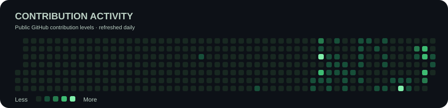

### Building practical technology with an out-of-the-box mindset

**Business Software** · **AI Workflows** · **Automation** · **Digital Experiences**

---

## `> whoami`

I build and explore business software, digital customer experiences and AI-assisted workflows. My goal is to make everyday business processes simpler through thoughtful technology and practical design.

## `> ls featured-projects/`

| Project | Focus | Source |
| :--- | :--- | :--- |
| **Resolvent Billing Software** | Billing, inventory and desktop business workflows | [Repository](https://github.com/neerajdes-dev/Billing-Software) |
| **WA CRM** | Customer engagement and WhatsApp-oriented campaign workflows | [Repository](https://github.com/neerajdes-dev/wacrm) |
| **VKare VCard** | Interactive digital business cards | [Repository](https://github.com/neerajdes-dev/vkare-vcard) |

Projects may be under active development and are not necessarily released products.

## `> cat current-focus.txt`

- **Build:** Reliable business applications with clear, usable interfaces.
- **Explore:** AI agents, intelligent automation and AI integrations.
- **Improve:** Deployment, desktop packaging, responsiveness and performance.
- **Design:** Premium, accessible experiences that work well on mobile.

## `> git log --activity`

The public contribution calendar refreshes via GitHub Actions after the workflow is enabled; scheduled runs may be delayed.

---

### `"Think out of Box"`

**Create useful things. Keep learning. Keep improving.**

[Explore all repositories](https://github.com/neerajdes-dev?tab=repositories)

